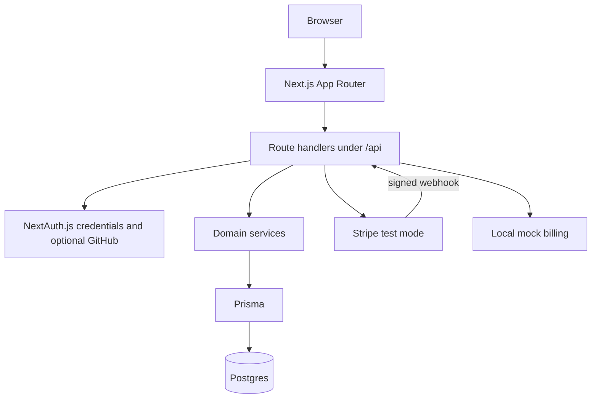
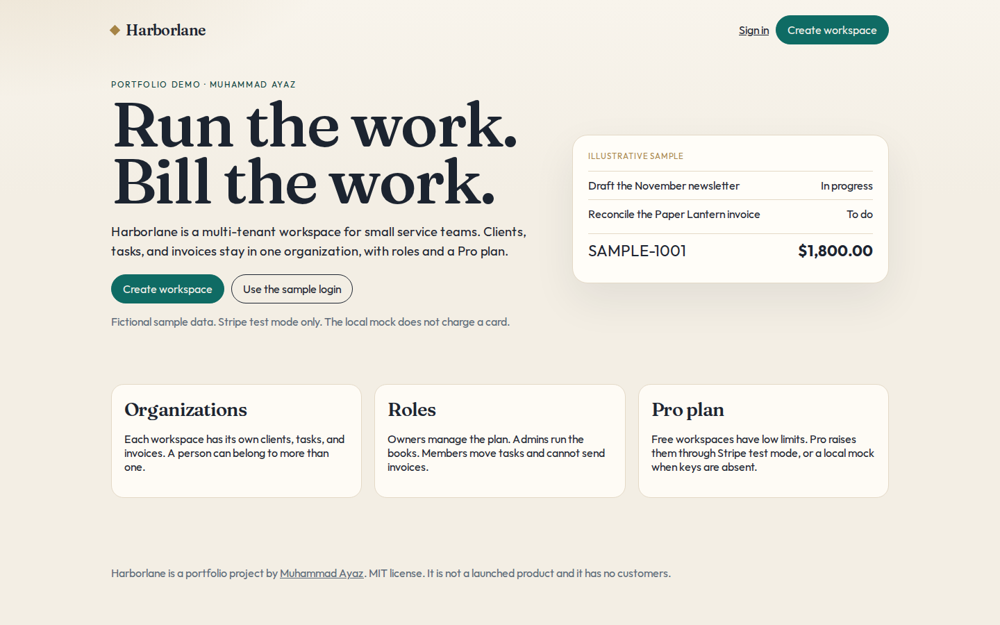
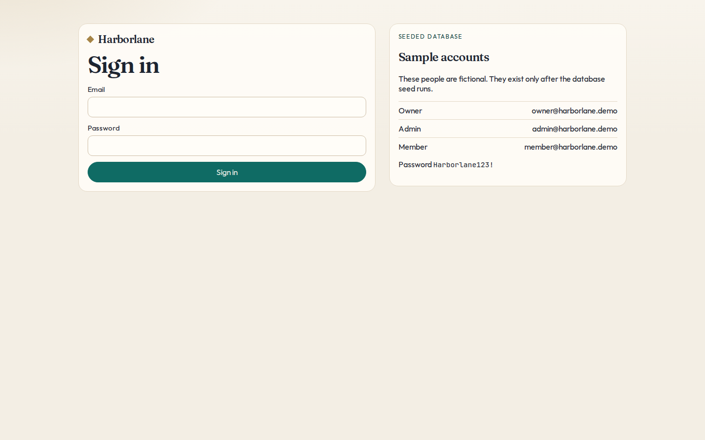
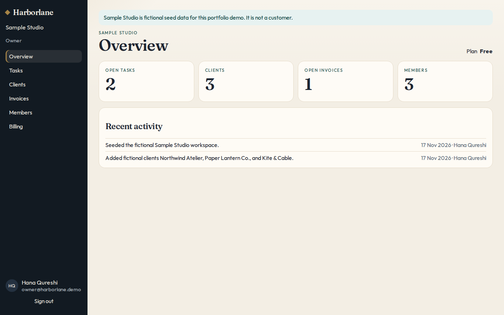
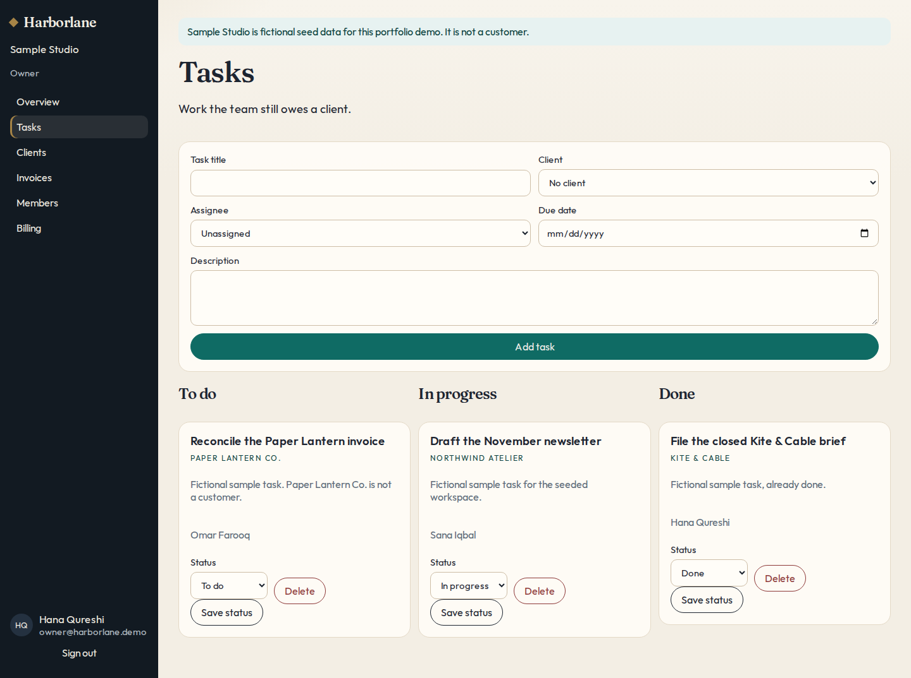
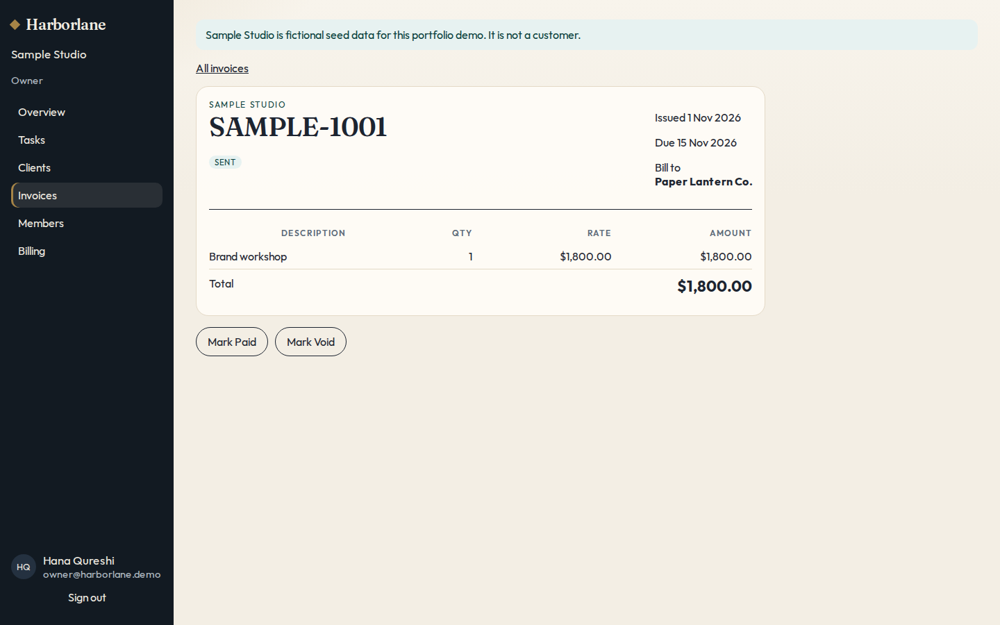
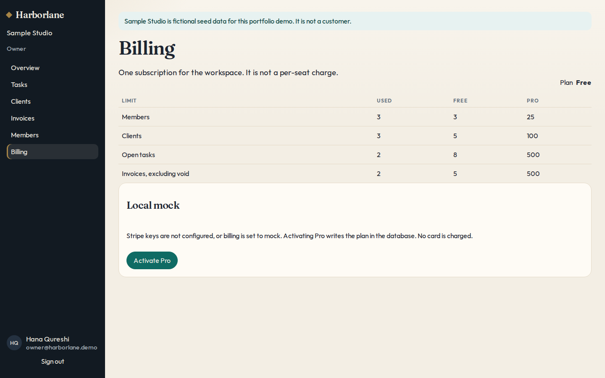

# Harborlane

Portfolio demo for [Muhammad Ayaz](https://github.com/AyazAI). Harborlane is a multi-tenant workspace where a small service team keeps clients, tasks, and invoices in one organization, with roles and a Pro plan.

This repository is named `nextjs-saas-demo`. A clearer name is **`harborlane`**. Renaming is left to the owner. The repository stays private.

Live demo: not deployed.

## Problem

Small teams split client work across a task list, a spreadsheet, and invoices. Harborlane puts those records in one workspace:

- An organization has members, clients, tasks, and invoices.
- Owners manage the plan. Admins run the books. Members move tasks and cannot create invoices.
- The Free plan has low limits. Pro raises them.

Sample Studio and its people are fictional seed data. They are not customers. Harborlane is not a launched product, and this README does not claim revenue, users, or client engagements.

## Architecture

The browser talks to one Next.js app. Route handlers under `/api` are the HTTP API. They call domain services, which use Prisma. Auth.js (NextAuth.js 4, the stable line) issues a JWT session. Billing either calls Stripe in test mode or updates the plan locally when Stripe is not configured.



Route handlers live in the Next.js app instead of a second Node service. One process can sit on a single free web service, shares TypeScript types with the UI, and still exposes a real HTTP API. A separate service would need another host, CORS, and its own deploy.

## Stack

| Piece | Choice |
| --- | --- |
| UI | Next.js 16 App Router, React, TypeScript |
| API | Next.js route handlers |
| Database | Postgres, Prisma 6, SQL migrations, seed |
| Auth | NextAuth.js 4.24.15: email and password, GitHub OAuth when configured |
| Billing | Stripe test mode, plus a mock path when keys are absent |
| Tests | Vitest for domain rules, Playwright against local Postgres |
| CI | GitHub Actions: lint, typecheck, unit tests, Playwright, build, gitleaks, Docker image build |

Prisma 6.19.3 is the classic `prisma-client-js` client. The npm `latest` tag for Prisma is currently an 8.0 release candidate. NextAuth.js v5 is still `5.0.0-beta` and is not the npm `latest` release, so this demo stays on the stable 4.24 line.

## Run it locally

Node.js 22 or newer, and Postgres 16.

```bash
cp .env.example .env
# Create the database from DATABASE_URL, then:
npm install
npx prisma migrate deploy
npm run db:seed
npm run dev
```

Open http://localhost:3000.

`npm run db:seed` resets **Sample Studio** (clients, tasks, invoices, extra members, and the plan) and recreates the fictional workspace. Other workspaces created through signup are left in place.

### Docker Compose

```bash
docker compose up --build
docker compose exec app npm run db:seed
```

The Compose app secret is a local placeholder. Postgres data lives in the `harborlane_pg` volume.

### Sample accounts

These accounts exist only after seeding. They are fictional.

| Role | Email | Password |
| --- | --- | --- |
| Owner | owner@harborlane.demo | Harborlane123! |
| Admin | admin@harborlane.demo | Harborlane123! |
| Member | member@harborlane.demo | Harborlane123! |

The login page lists them when the owner account is in the database.

## Tests

```bash
npm run lint
npm run typecheck
npm run test:unit
npm run db:seed
npm run build
npm run test:e2e
```

Playwright starts `next start` on port 3000, so build before the end-to-end run. Unit tests do not need Postgres. End-to-end tests do.

`npm run screenshots` writes the images in `docs/screenshots/` from the running app.

## Billing

Default `BILLING_MODE=mock`. The owner can activate Pro in the app. That writes the plan in Postgres. No card is charged, and Stripe is not called.

Set `BILLING_MODE=stripe` only with **test mode** values:

- `STRIPE_SECRET_KEY` — `sk_test_...`
- `STRIPE_WEBHOOK_SECRET` — from `stripe listen` or a test webhook endpoint
- `STRIPE_PRICE_ID` — a recurring test-mode price

Checkout redirects to Stripe. The plan changes when `POST /api/billing/webhook` accepts the signed event (`checkout.session.completed`, `customer.subscription.updated`, `customer.subscription.deleted`). Use the test card `4242 4242 4242 4242`. Do not put live keys (`sk_live_...`) in this project.

If the three Stripe variables are set and `BILLING_MODE` is unset, the app selects Stripe. `BILLING_MODE=mock` always wins, so a copied test key cannot surprise you.

Amounts in the API are dollar strings (`"150.50"`) and are stored as integer cents.

## API

Session cookie required, except signup, auth, health, and the Stripe webhook.

| Method | Path | Purpose |
| --- | --- | --- |
| GET | `/api/health` | Postgres connectivity |
| POST | `/api/signup` | Create a user, a workspace, and an owner membership |
| GET, POST | `/api/orgs` | List or create workspaces |
| POST | `/api/session/org` | Switch the active workspace |
| POST | `/api/orgs/:orgId` | Rename, or delete when `_action=delete` and `confirm=delete` |
| GET, POST | `/api/orgs/:orgId/members` | List or invite by existing email |
| POST | `/api/orgs/:orgId/members/:membershipId` | Change role or remove |
| GET, POST | `/api/orgs/:orgId/clients` | List or create clients |
| GET, POST | `/api/orgs/:orgId/tasks` | List or create tasks |
| POST | `/api/orgs/:orgId/tasks/:taskId` | Change status or delete |
| GET, POST | `/api/orgs/:orgId/invoices` | List or create invoices |
| GET, POST | `/api/orgs/:orgId/invoices/:invoiceId` | Read, change status, or delete a draft |
| POST | `/api/billing/checkout` | Stripe test checkout, or the mock explanation |
| POST | `/api/billing/webhook` | Signed Stripe events. Disabled in mock mode |
| POST | `/api/billing/mock-activate` | Set Pro without Stripe |
| POST | `/api/billing/mock-cancel` | Return to Free without Stripe |

HTML forms POST to the same routes and receive redirects. JSON clients receive JSON.

## Limits

| | Free | Pro |
| --- | ---: | ---: |
| Members | 3 | 25 |
| Clients | 5 | 100 |
| Open tasks | 8 | 500 |
| Invoices, excluding void | 5 | 500 |

Going back to Free does not delete records that are already over the cap. It blocks new ones.

## What is intentionally missing

- No email delivery. An invite works only when the person already has an account.
- No password reset.
- No login rate limit.
- GitHub sign-in joins an existing user when the email matches. Create a GitHub OAuth app and set `AUTH_GITHUB_ID` and `AUTH_GITHUB_SECRET` to show the button. Callback: `{NEXTAUTH_URL}/api/auth/callback/github`.
- USD only.
- JWT sessions. The credentials provider does not store sessions in Postgres.

## Deploy a free demo

Nothing in this repo has been deployed. Do not use a paid plan or live Stripe keys.

A practical free path is **Vercel Hobby** for the Next.js app and **Neon** (or Supabase) for Postgres. A Render free **web service** also works: bind `0.0.0.0` and `$PORT` (the start script and Dockerfile already do), and expect the free instance to sleep after about 15 minutes. The filesystem is ephemeral, so the database has to be hosted elsewhere. Route handlers and webhooks need that web service.

Suggested commands:

- Build: `prisma generate && next build`
- Start: `next start -H 0.0.0.0` (Render). Vercel builds and serves Next.js itself.
- Release: `prisma migrate deploy` against the hosted database.

Environment variables to set in the host, from `.env.example`:

| Variable | Required | Notes |
| --- | --- | --- |
| `DATABASE_URL` | Yes | Neon or Supabase **pooled** URL for the app. Use the direct URL for `migrate deploy` if the host requires it. |
| `NEXTAUTH_URL` | Yes | Public origin, for example `https://your-app.vercel.app` |
| `NEXTAUTH_SECRET` | Yes | `openssl rand -base64 32`. Not the placeholder in `.env.example`. |
| `BILLING_MODE` | Yes for a first demo | `mock` until Stripe test keys exist |
| `STRIPE_SECRET_KEY` | Only for Stripe | Test secret key |
| `STRIPE_WEBHOOK_SECRET` | Only for Stripe | Test webhook signing secret |
| `STRIPE_PRICE_ID` | Only for Stripe | Recurring test price |
| `AUTH_GITHUB_ID` | No | GitHub OAuth client id |
| `AUTH_GITHUB_SECRET` | No | GitHub OAuth client secret |

Ayaz needs to create those accounts and keys himself: a Vercel or Render account, a Neon or Supabase project, a generated `NEXTAUTH_SECRET`, and optionally a GitHub OAuth app and a Stripe **test** product. This project does not provision them.

After the first deploy, run `prisma migrate deploy`. Run `npm run db:seed` only if the sample login should work. Seeding a public URL publishes the demo password above. The sample workspace holds fictional data, but anyone with the password can sign in as the owner.

Stripe webhooks need the public HTTPS URL `https://<host>/api/billing/webhook` and the test signing secret. The mock path works with no Stripe account.

## Decisions still open

- Rename the repository to `harborlane`, or pick another product name. Leave it private until there is a deliberate choice to show it publicly. A private repo is not visible to a hiring manager.
- Host the free demo on Vercel + Neon, or on Render + Neon/Supabase.
- Seed the live demo (shared sample login) or leave it signup-only.
- Turn on GitHub OAuth, Stripe test checkout, or keep the local mock.
- Replace Harborlane if a different small product is a better portfolio fit.

## Screenshots

Taken with Playwright from the running app and the seeded database.













## License

MIT. Copyright 2026 Muhammad Ayaz.
